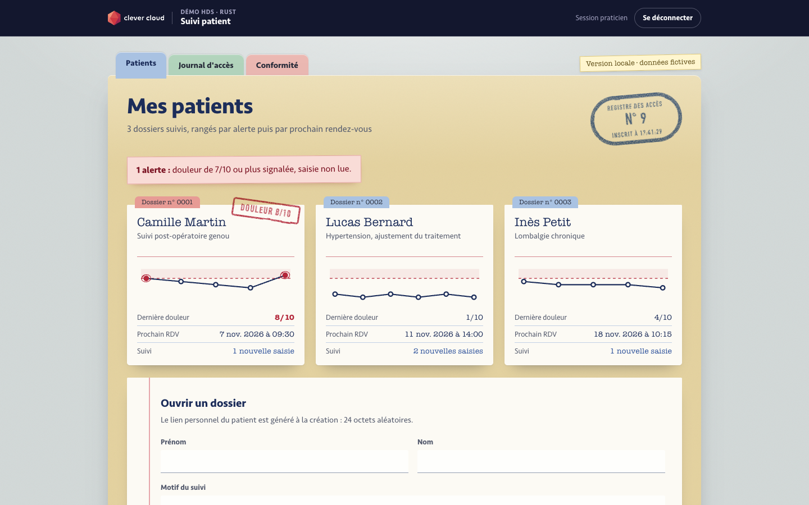
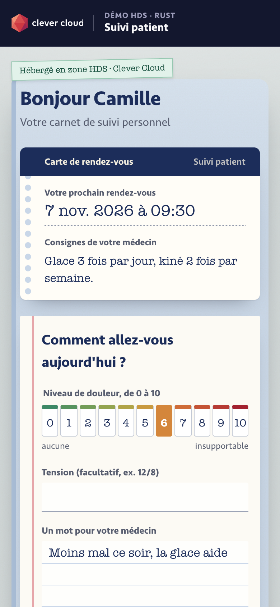
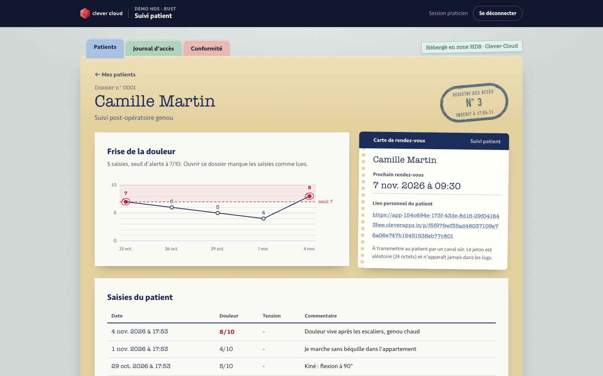
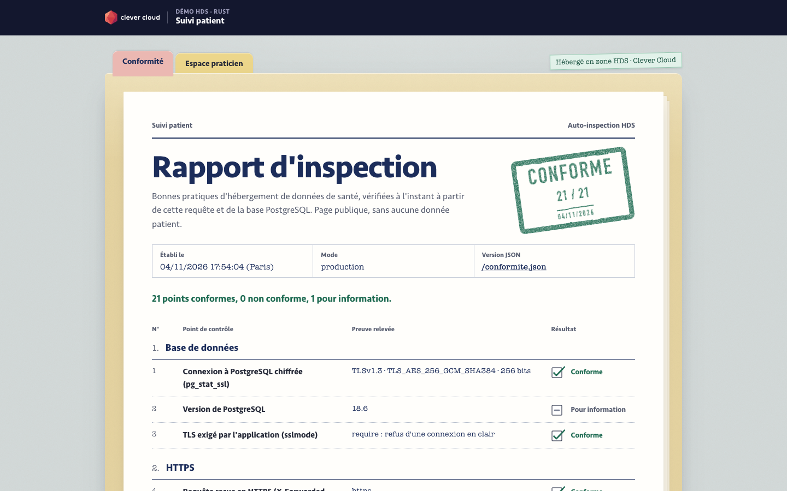
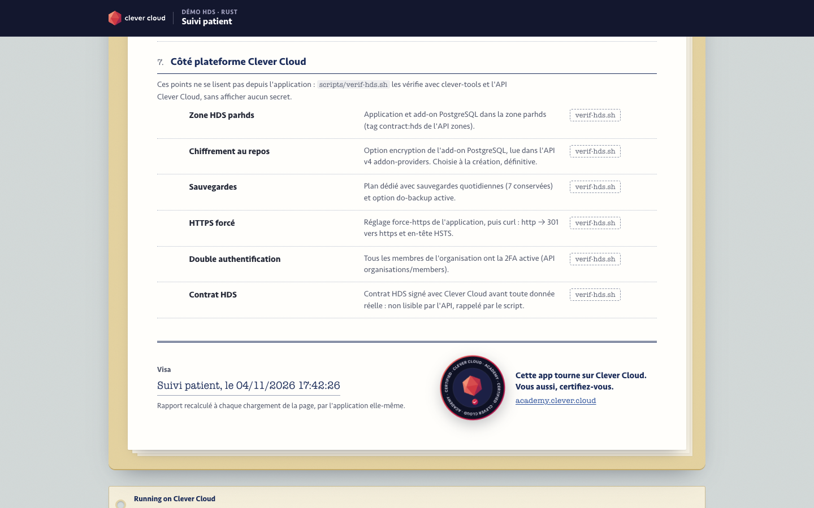

# The Patient File — Rust and PostgreSQL in the HDS zone on Clever Cloud

> A patient follow-up app for a doctor's practice, drawn as a **paper medical file** and deployed in Clever Cloud's **HDS zone** (`parhds`, Paris, certified for health data hosting). The practitioner's space is a manila folder with coloured tabs: each patient is an index card with a small pain chart drawn in SVG, and a red stamp when they report a pain of 7/10 or more. The patient's personal link is an appointment card, where they say how they feel on a 0 to 10 scale. Every access lands in a numbered, append-only register (a PostgreSQL trigger refuses any erasure), and each page that opens patient data shows the register number it has just written, as a blue rubber stamp. The public page `/conformite` is an **inspection report**: 21 HDS good practices checked live, from the request itself and from the database (TLS version and cipher read in `pg_stat_ssl`, security headers, session, log trigger), with the proof typed on each line and a final stamp. `scripts/verif-hds.sh` checks the platform side: zone, encryption at rest, backups, forced HTTPS, 2FA. One binary on the **native Rust runtime**, no Dockerfile, a **PostgreSQL add-on** on a dedicated plan, encrypted at rest, and no third-party resource at all: system fonts, SVG drawings, no JavaScript.





**Screenshots taken on Clever Cloud, HDS zone (`parhds`), 4 November 2026**, after following [Deploy on Clever Cloud](#deploy-on-clever-cloud) to the letter: full `clever deploy` in 1 min 33 s (first build, `cargo build --release --locked` 26 s on the dedicated M build), `/conformite` 21 OK, 0 KO, 1 info (PostgreSQL 18.6 over TLSv1.3), `verif-hds.sh` 9/9. App and database deleted afterwards.

**Run it yourself.** The hosted demo was taken down after the presales review (November 2026). The steps in [Deploy on Clever Cloud](#deploy-on-clever-cloud) recreate it from scratch in about 5 minutes.

**Get certified.** This demo runs on Clever Cloud. To deploy your own apps the same way, get certified at the [Clever Cloud Academy](https://academy.clever.cloud/).

**Fictional data only;** production health data requires a signed HDS contract with Clever Cloud.



## What the HDS zone does here



| Practice | How | Where you see it in the file |
|---|---|---|
| HDS zone | `--region parhds` for the app and the database | Report part 7, checked by `verif-hds.sh` (zone tagged `contract:hds` in the zones API) |
| Dedicated plan, not DEV | `--plan xxs_sml`: dedicated instance, 45 connections, backups. The DEV plan is shared, without encryption or backups | Report part 7, `verif-hds.sh` |
| Encryption at rest | `--option encryption=true` when the database is created, permanent | Report part 7, `verif-hds.sh` (API v4 addon-providers) |
| TLS everywhere | Database in `sslmode=require` (the app refuses `PG_SSL=disable` in production); HTTPS in the browser | Report line 1: TLS version and cipher read in `pg_stat_ssl` |
| Forced HTTPS + HSTS | `clever config set force-https true`, a 301 redirect in the app too, HSTS for one year | Report lines 4 to 6, `verif-hds.sh` (curl http → 301) |
| Security headers | Strict CSP (`default-src 'none'`, `frame-ancestors 'none'`, no script at all), `nosniff`, `Referrer-Policy`, `Cache-Control: no-store` | Report lines 6 to 11, each with the header value typed as proof |
| No direct access to instances | Only the Clever Cloud load balancer is exposed; no direct host or port access; interventions through the platform's authenticated tools (Console, `clever ssh`) | Console |
| 2FA for every member | Enabled on every account of the organisation | Report part 7, `verif-hds.sh` (organisations/members API) |
| Least privilege | Organisation roles: Developer to deploy, Accountant for billing, Admin restricted | Console › Members |
| Secrets in variables | `clever env set`, password generated without being shown, `.env` ignored by git | `clever env` (names only) |
| Logs without health data | One line per request: method, path, status, duration. The `/p/…` token is masked, never a name or a comment, SQL errors reduced to their SQLSTATE code | Report lines 21 and 22, `clever logs` |
| Access register | Table `journal_acces` (who, what, which patient, when, IP), append-only: a trigger refuses UPDATE, DELETE and TRUNCATE | The blue register stamp on the practitioner's pages (a line on the patient's), the numbered register at `/journal` (the line just written is highlighted), report lines 18 to 20 (`pg_trigger`) |
| Short sessions | Server-side session, 15 min of inactivity, 8 h at most; cookie `HttpOnly`, `SameSite=Strict`, `Secure` (`__Host-`); 5 failures from one IP block it for 15 min; cross-origin writes refused (CSRF) | Report lines 12 to 17 |
| Daily backups | Included in the dedicated plan (7 kept) | Report part 7, `verif-hds.sh`, Console › Backups |
| Custom domain + HDS contract | No production on `cleverapps.io`; HDS contract signed before any real data | [Before real health data](#before-real-health-data) |

`/conformite` (and `/conformite.json`, unchanged) holds no patient data: 21 checks plus the PostgreSQL version, computed at each load, and the six platform points that `verif-hds.sh` covers. The final stamp reads **Conforme** when no line fails. On Clever Cloud (`parhds`, 4 November 2026) the page read 21 OK, 0 KO, 1 info (the PostgreSQL version). Run locally, the database TLS line fails and the sslmode, HTTPS and Secure-cookie lines are information only. The PostgreSQL add-on's TLS certificate is self-signed: `require` encrypts the connection without verifying the chain.



The report closes on a visa and a seal: the Clever Cloud Academy badge, with "Cette app tourne sur Clever Cloud. Vous aussi, certifiez-vous." and a link to [academy.clever.cloud](https://academy.clever.cloud). Every other page carries the same invitation at the foot of the folder, next to the "Running on Clever Cloud" archive label (`CC_APP_NAME`, `APP_ID`, `INSTANCE_NUMBER`, `INSTANCE_TYPE`, `CC_PRETTY_INSTANCE_NAME`, short `CC_COMMIT_ID`, `CC_DEPLOYMENT_ID`; "Local" outside the platform).

## Deploy on Clever Cloud

You need [clever-tools](https://www.clever.cloud/developers/doc/cli/) (`clever login` done), `jq` and `curl` for the check script, and the ID of the organisation that will own the resources (`orga_…`, shown in the Console), with 2FA on for all its members. Run the commands from the repo root, with at least one commit: `clever create` links the folder to the new app.

```bash
# 1. The app and its size, in the HDS zone
clever create --type rust demo-rust-hds --org <org_id> --region parhds
clever scale --build-flavor M        # before the first deploy: off by default, cargo would saturate the nano instance
clever scale --flavor nano
clever scale --min-flavor nano --max-flavor XS --min-instances 1 --max-instances 2

# 2. PostgreSQL: dedicated plan, same zone, encrypted at rest (chosen at creation only), daily backups included
clever addon create postgresql-addon demo-rust-hds-db --plan xxs_sml --option encryption=true --region parhds --org <org_id> --yes
clever service link-addon demo-rust-hds-db

# 3. Variables; the practitioner password is generated into a file outside the repo, never shown
clever env set APP_ENV production
clever env set SEED_DEMO true
clever env set PRATICIEN_LOGIN admin
(umask 077 && openssl rand -hex 16 > "$HOME/.demo-rust-hds.pwd")
clever env set PRATICIEN_PASSWORD "$(cat "$HOME/.demo-rust-hds.pwd")" > /dev/null
clever env set CC_CACHE_DEPENDENCIES true
clever env set CC_HEALTH_CHECK_PATH /health

# 4. HTTPS forced by the platform
clever config set force-https true

# 5. Deploy: cargo build --release --locked, then migrations and 3 fictional patients at startup
clever deploy
clever domain

# 6. Check the platform side
./scripts/verif-hds.sh demo-rust-hds
```

Then open `https://<domain>/conformite`, and `https://<domain>/connexion` with `admin` and the password in `~/.demo-rust-hds.pwd` (`pbcopy < ~/.demo-rust-hds.pwd` on macOS).

Measured on 4 November 2026 (app in `parhds`, dedicated M build), following these steps to the letter:

| Step | Time |
|---|---|
| `clever create` | 1 s |
| `clever scale` (3 commands) | 2 s |
| `clever addon create` + `link-addon` | 2 s (database `ACTIVE`, encrypted, backed up) |
| Variables and `force-https` | 5 s |
| First build on Clever Cloud | 41 s, of which `cargo build --release --locked` 27 s and 20 s uploading the caches |
| Full `clever deploy` (push, queue ~11 s, build, start and `/health` 10 s) | 1 min 30 s |
| `verif-hds.sh` | 9/9 checks green |

At startup the app reached PostgreSQL 18.6 over TLSv1.3 (`TLS_AES_256_GCM_SHA384`), and ran the migrations and the seed in under a second. `force-https` was already `ENABLED` before step 4 (likely the default in `parhds`); the command keeps the setting explicit and checkable. The add-on also answers from a laptop: `pg_isready` succeeds and a `pg_dump | psql` copy over TLS copied 50 of 50 rows; `/conformite` stays the quickest check, without handling any credential. A clean local build (Mac M, 194 crates) takes 42 s.

## Variables

| Variable | Set by | Role |
|---|---|---|
| `POSTGRESQL_ADDON_URI` | PostgreSQL add-on (link) | Connection string, read directly; never copy it into `DATABASE_URL` |
| `APP_ENV` | you | `production`: HTTPS redirect (except `/health`), `__Host-session` Secure cookie, password of 12 characters or more, TLS to the database. Otherwise the app refuses to start |
| `PRATICIEN_LOGIN` | you | Practitioner login (default `admin`) |
| `PRATICIEN_PASSWORD` | you, generated | Practitioner password, required |
| `SEED_DEMO` | you | `true`: 3 fictional patients when the database is empty (advisory lock, so two instances never seed twice) |
| `CC_CACHE_DEPENDENCIES` | you | `true`: compiled dependencies reused between deployments |
| `CC_HEALTH_CHECK_PATH` | you | `/health`: 200 only when the database answers |
| `DB_POOL_MAX` | optional | Connections per instance, default 2 (45 at most on `xxs_sml`, all instances together) |
| `PG_SSL` | local only | `disable` for a local PostgreSQL without TLS; refused with `APP_ENV=production` |
| `DATABASE_URL` | local only | Used when `POSTGRESQL_ADDON_URI` is absent |
| `PORT` | Clever Cloud | 8080 |

## Routes

Unchanged by the paper-file redesign:

| Route | In the file |
|---|---|
| `/` | → `/praticien` |
| `/connexion`, `/deconnexion` | The closed folder, stamped "Confidentiel", with the sign-in label |
| `/praticien` | The open folder: one index card per patient (mini pain chart, alert stamp), new-patient sheet |
| `/praticien/patients/{id}` | The patient's file: pain chart, appointment card with the personal link, entries, instructions |
| `/p/{jeton}` | The patient's booklet: appointment card, 0 to 10 pain scale, own chart (token: 24 random bytes) |
| `/journal` | The numbered access register, current line highlighted |
| `/conformite`, `/conformite.json` | The inspection report (public), and the same checks in JSON |
| `/health` | Database `SELECT 1` |
| `/cc-brand.css`, `/app.css` | Clever Brand Kit and the paper-file styles |

## Code tour

```
src/main.rs          configuration, middleware (HTTPS, CSRF, headers, logs), routes
src/auth.rs          sign-in, server-side sessions, block after 5 failures, client IP (unit tests)
src/pages.rs         practitioner pages, patient page, access log, demo data
src/conformite.rs    the checks behind /conformite and /conformite.json
src/html.rs          HTML pages (format! + escaping): folder, index cards, SVG pain chart, stamps, report
src/migrations.rs    migrations embedded in the binary (include_str!, no sqlx macros: shorter build)
migrations/          SQL schema, with the append-only trigger
static/              Clever Brand Kit (cc-brand.css, logo, Academy badge) and app.css; system fonts, no third-party resource, no script
scripts/verif-hds.sh platform checklist, no secret printed; reads .clever.json in the demo folder or at the git root, or takes an app_… ID
```

Rust 1.85+, axum 0.8, sqlx 0.8 (PostgreSQL, rustls), server-rendered HTML.

## Run locally

With a local PostgreSQL without TLS:

```bash
createdb suivi_patient_hds
cp .env.example .env          # fictional values, admin / admin
set -a && . ./.env && set +a
cargo run --release           # http://localhost:8080
cargo test                    # client IP parsing, pain chart (5 tests)
```

Locally `admin` / `admin` is accepted and a "Version locale · données fictives" label is pinned on the folder (in production: "Hébergé en zone HDS · Clever Cloud"). `PG_SSL=disable` is accepted only outside production.

## Before real health data

1. A signed **HDS contract** with Clever Cloud (scope, host and data controller roles).
2. A **custom domain**: `clever domain add <your-domain>`, CNAME to Clever Cloud, automatic certificate.
3. **Named sign-in**: one account per practitioner with a second factor (Pro Santé Connect or OpenID Connect) instead of the single account.
4. **Patient links** with a limited lifetime, revocable, sent through a controlled channel (MSSanté).
5. **Access log** kept for the regulatory period and exported out of the database (SIEM); a separate PostgreSQL role for the app, without rights on the trigger.
6. **Database** sized to use, backup retention aligned with the impact assessment (DPIA); certificate verification (`verify-full`) only works by pinning the add-on's self-signed certificate by hand, as no CA certificate variable is provided.
7. **Resilience**: at least 2 instances (`clever scale --min-instances 2`), alerts.
8. **Shared brute-force counter**: the failure counter lives in memory, per instance; share it (HDS Redis) beyond one instance.
